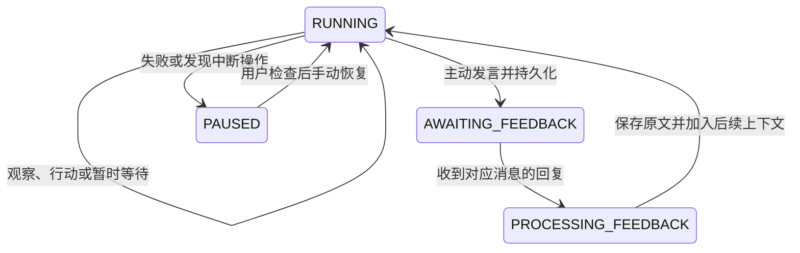

# 开发说明

## 运行协议



等待反馈时不观察桌面、不调用模型、不执行动作、不启动学习。回复绑定消息 ID，重复回复、过期回复和空白回复均被拒绝。接收原文与判断其含义分开；当前反馈处理只将原文提供给后续模型决策，尚未自动生成奖励或参数更新。

每轮先持久化操作意图，再逐步记录观察、模型输出、动作请求和结果。模型 JSON 解析失败时保存原始输出并暂停。调用模型可有限重试，桌面动作不自动重试。SQLite 无法与外部桌面形成一个事务；发生崩溃时选择记录结果未知并暂停。

`runner.lock` 防止同一状态目录同时运行两个 Agent。用户可从另一进程提交回复。guest 服务另有持久操作账本：同 ID 同请求返回已有结果，同 ID 不同请求拒绝执行，已经开始但无结果的动作拒绝重放。

## 模块

| 文件 | 职责 |
| --- | --- |
| `contracts.py` | 严格的观察、决策、动作和目标结构 |
| `config.py` | 配置校验与路径解析 |
| `store.py` | 经历、消息、目标、状态和恢复 |
| `runtime.py` | 一轮自主决策和动作执行 |
| `model.py` | 远程推理，以及显式选择的离线脚本后端 |
| `environment.py` | 真实笔记文件环境与 macOS bridge 客户端 |
| `guest.py` | 认证 HTTP 服务与动作账本 |
| `guest_macos.py` | 限定 Apple Virtualization 客体的辅助功能接口 |
| `cli.py` | 运行、交流、检查和导出入口 |

## 验证

```sh
./dev sync --locked
./dev run ruff check .
./dev run ruff format --check .
./dev run pytest -q
./dev run python -m compileall -q src
./dev run paimon doctor --config configs/local.example.toml
./dev build --no-sources
```

Linux 和 macOS CI 执行相同检查。HTTP 测试使用受控响应，不会调用付费服务或操作桌面。原生 AX 调用还需要在实际虚拟机中验证。

真实集成验收应记录：模型 ID 与固定版本、运行框架版本、实际 GPU 占用、一次完整结构化输出的延迟；随后完成真实观察与动作、主动发言、进程重启、对应回复及下一轮决策。保存原始经历，准确标注演示和人工构造的测试反馈。

## 下一里程碑：真实参数更新

当前没有参数学习。`learning.enabled = true` 会直接拒绝启动。先完成真实模型与虚拟机闭环，再实现一条手动触发的 LoRA 路径：

1. 从已记录经历选出训练候选，并保留原始来源事件。
2. 确定训练目标和要更新的模块；不自动将所有模型输出当成正确示范。
3. 在远程独立训练环境生成适配器，记录数据、基础模型、超参数和产物版本。
4. 显式加载适配器，检查其确实生效，并在相同记忆条件下比较保留情境。

评价、情绪、潜空间通信和自主训练调度仍待设计。外部记忆、参数学习和运行机制改动分别记录。

## 迁移

新 Mac 重新生成 Python 环境，单独迁移个人配置、密钥和停止后的 `runtime/`。复制 SQLite 时先停止运行，或使用 SQLite backup API；避免只复制仍在写入的主数据库文件。UTM 虚拟机需关机后迁移完整 `.utm` 包。不要复制 `.venv` 或本机工具缓存。
